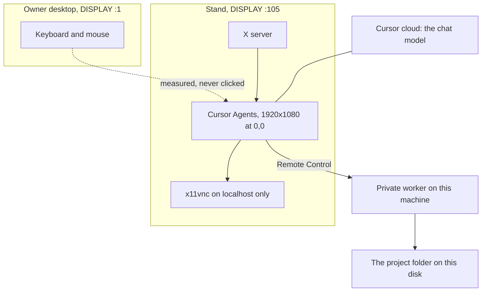
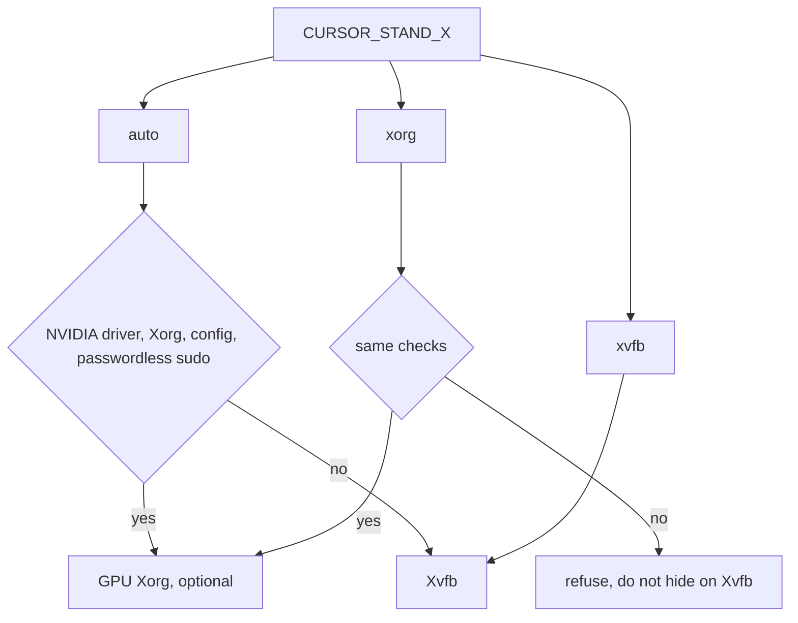
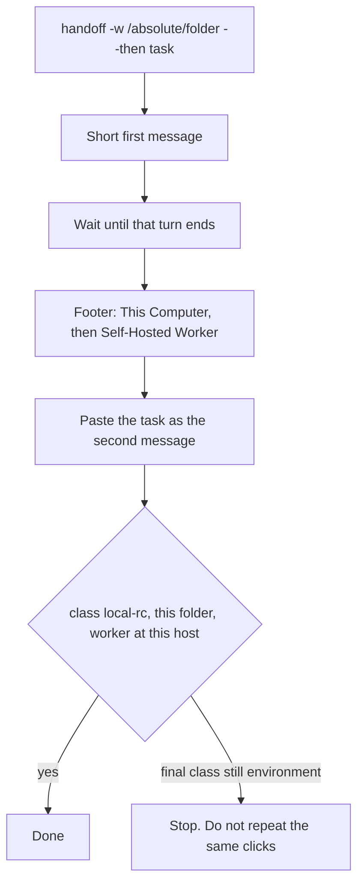

# Curskill (Agents Window + Remote Control)

Russian: [SKILL.ru.md](SKILL.ru.md). English is the copy the agent follows.

There is no API for "a new glass tab plus `/remote-control`". The `agent`
CLI and Cloud Agents are **other** sessions. Do not click the owner's
desktop. The working path is computer use on **this stand's** DISPLAY.

Why that display exists: [README.md](../README.md). In short, Remote
Control on this machine is a desktop Agents window whose tools run here
as a private worker. The script raises a second X11 server so those clicks
do not move the owner's mouse, and it repeats a UI sequence that has no
stable API. Success is a `local-rc` row in the stand profile, not a
screenshot.

This is the orchestrator for Cursor Agents Window sessions on Linux and
X11. Not Windows, not macOS, not Wayland.

<a id="layout"></a>

## How it is put together

The owner's desktop and the stand do not share a mouse.



What paints the window is optional. The clicks and the success check stay the same.

Cursor Agents is an Electron window, so something has to paint it. Xvfb paints it on the CPU, llvmpipe or SwiftShader, about 0.6 of a core for as long as the window is up. That is a whole stand: the same OCR, the same handoff, no root, and it does not touch a GPU a person may be watching. NVIDIA Xorg paints that same window on the card, which is why a stand left up all day uses the card when it can: the CPU cost goes away, the session does not. Use the GPU only for NVIDIA, only when Xorg can start without a password, and only when nobody is at that monitor. AMD and Intel are not implemented. `CURSOR_STAND_X=xvfb` skips the GPU on purpose. `auto` takes it when those pieces are present and otherwise says so and uses Xvfb. `xorg` means the GPU or a refusal, not a quiet fallback.



A new session is one sequence. A picture of the words "This Computer" is not the end of it.



The row that counts is the one after `handoff` returns. While `convert-ok` is still waiting, a git folder can read `class=environment` and `workspaceRootPath=/workspace`. Measured 2026-11-25 on k-99: `/data/pro/mqlab` (`gitRepo:github.com/kogriv/mqlab`) stayed environment from 10 s through 50 s and became `local-rc` at 60 s. The same day `/tmp/curskill-e2e-20261125`, which has no GitHub remote, was `local-rc` at 8 s. That middle row is not a reason to stop, to rename, or to start a second handoff. Stop only when the finished command still reports environment. Details: [reference.md](reference.md).

**A new machine.** Read [SETUP.md](../SETUP.md) first: requirements, the
host file, the person's yes. `scripts/setup.sh` only checks commands and
installs nothing. Until the host file has `CURSKILL_SETUP_DONE=1`,
`doctor` does not click the glass UI. `up` and the timer wait until the
person says to bring the stand up.

**Before any work on a stand that is already set up,** re-read this
`SKILL.md` from disk and run `scripts/doctor.sh`. On a free living stand
with `CURSKILL_SETUP_DONE=1`, doctor clicks `handoff --dry-run` (no Return
and no text). It does not click a busy stand. Screen:
[display.md](display.md). Hosts: [hosts.md](hosts.md). Failures:
[reference.md](reference.md).

## Who reads this skill

One copy, two agents. Cursor loads `.cursor/skills/curskill/`. Claude Code
loads `.claude/skills/curskill` (a symlink to the same directory).
Everything below this section is shared. The differences are only here.

| | Cursor agent (glass / RC on the stand) | Claude Code (tmux on the host) |
|---|---|---|
| where it lives | `skill/` of the `curskill` repo; `install/install.sh` links `~/.cursor/skills/curskill` | the same `skill/` via `~/.claude/skills/curskill` |
| how it is picked up | a new chat in a folder where the skill is installed; or `/curskill` | a new or restarted session; or `/curskill` |
| how to see that it is visible | Customize → Skills | the skill is in the session list; `/curskill` is not "Unknown skill" |
| why `park`, `ensure`, and a stand restart are dangerous | **you kill yourself**: your worker is a process of this Cursor, and the turn stops | you kill **other** running agents: first `scripts/glass.sh busy "$(hostname)"` |
| default `DISPLAY` | often `:105` (the stand) | empty or `:1` (the owner's desktop) — always set `DISPLAY=` to the stand |
| who your worker is | `--worker-dir` of your folder `@ <hostname>` from the stand profile | you have no workers; you are not in `glass.sh mine` |

Shared:

- The script canon is `automation/cursor-stand.sh` in the same repo, next
  to `skill/`. `install/install.sh` links `~/.cursor/skills/curskill` and
  `~/.claude/skills/curskill` at `skill/`. It links the skill only. It does
  not switch the stand timer or a screen that is already up.
- A session in a workspace where the skill is not installed will not see it.
- Auto-invocation is on (no `disable-model-invocation`): the description
  should match "raise an agent / RC / rename / MCP".
- Observed, not confirmed by Cursor's docs (2026-10-07): an RC /
  self-hosted worker does not see `~/.cursor/skills/`. A chat started
  before the skill appeared does not pick it up.

## Call the scripts, do not rewrite them

Canon (git): `automation/cursor-stand.sh`, `glass_agents.py`.
Do **not** copy the screen script into the skill. It is
`automation/display/stand-display.sh`. Another screen script is
`CURSOR_STAND_DISPLAY_SH`.

Paths below are from this skill's root. `scripts/stand.sh` resolves the
canon (`CURSOR_STAND_SH=` if you must). What each command does, and what
it does not do, is [capabilities.md](capabilities.md). The block below is
the same commands in the order the agent runs them.

```bash
scripts/doctor.sh
scripts/pick-display.sh
scripts/stand.sh status
scripts/stand.sh up                          # no folder path in argv
scripts/stand.sh workers                     # folder workers @ this machine
scripts/stand.sh ensure                      # what the timer does; by hand only when asked
scripts/stand.sh handoff -w /ABS/PROJECT -n name --then 'task'
scripts/stand.sh handoff -w /ABS --no-convert   # local chat; convert later
scripts/stand.sh convert --id <uuid|bc-|name> [-w /ABS] [-n name]
scripts/stand.sh convert --id … --dry-run
scripts/wait-worker.sh /ABS/PROJECT
scripts/stand.sh composer-send --id bc-…     # resend; the input box is found on the shot
scripts/stand.sh rename --id bc-… name
scripts/stand.sh archive --id bc-…           # probes and mistakes; not a running one
scripts/stand.sh discard --id <uuid>         # draft with no database row
scripts/glass.sh inventory                   # profile tabs, including local-draft
scripts/stand.sh mcp ready NAME --id bc-…    # server is visible to this local-rc tab
scripts/stand.sh mcp list                    # Customize → MCPs
scripts/stand.sh mcp find NAME
scripts/stand.sh mcp enable NAME             # source toggle ON
scripts/stand.sh mcp disable NAME
scripts/stand.sh mcp add -w /ABS -n NAME --command /path [--arg …]
scripts/stand.sh mcp add --user -n NAME --command /path
scripts/stand.sh settings agents             # Settings → Agents, read only
scripts/stand.sh shot
scripts/glass.sh selected
scripts/glass.sh newest /ABS/PROJECT [since_ms]   # class=local-rc only
scripts/glass.sh show bc-…
scripts/glass.sh created-since <epoch_ms>
scripts/glass.sh handoff-ok /ABS/PROJECT [since_ms [uuid]]
scripts/glass.sh mine "$(hostname)"          # local-rc + local; working column
scripts/glass.sh busy "$(hostname)"          # status=1, plus a local selected with no row
```

Handoff and MCP clicks are OCR anchors in `glass_agents.py`, not fixed
points. Do not click with `xdotool` from chat while a script command
exists. After a Cursor UI change, run `doctor` / `handoff --dry-run`. An
unrecognized anchor is a refusal before Return. Read
[reference.md](reference.md).

Text onto the stand: not `xdotool type` (IBus stays silent). The script
uses `xclip -display $DISP` plus ctrl+v.

## Screen and rendering

The stand is a **second X server**, not a window on the owner's desktop.

| layer | what |
|---|---|
| Display | `CURSOR_STAND_DISPLAY`, default `:105` |
| Glass window | on that display, `0,0` × `1920×1080` (`agents_window`) |
| Viewing | x11vnc `localhost:5916` (`-localhost`, password file `$PROFILE/var/vnc.pass`) |
| Owner's desktop | `CURSOR_STAND_ORIG_DISPLAY`, default `:1` — mouse measurement only |
| Owner's keyboard | not taken: `AutoAddDevices off`, `-sharevts -novtswitch` |

What **draws** the screen is `CURSOR_STAND_X` (read by `stand-display.sh`),
not an interview in chat. Before the first `up` on a host:
`scripts/pick-display.sh`.

| `CURSOR_STAND_X` | behavior |
|---|---|
| `auto` (default) | NVIDIA Xorg when `nvidia_drv.so` + xorg config + `Xorg` + NOPASSWD/wrapper are all present; otherwise a **loud** fallback to Xvfb |
| `xorg` | GPU Xorg only, otherwise a refusal (no quiet Xvfb) |
| `xvfb` | software rendering immediately |

The GPU is optional. Why it is worth having, and when to skip it, is in
[How it is put together](#layout). This table is only the
switch. NVIDIA only. AMD, Intel, and Wayland are not implemented.

Do not raise a second Xorg on the same card while a person is at the
physical monitor: the screen can blink. If `:1` is unreachable, mouse
isolation cannot be measured. That does not forbid handoff.

`up` does not duplicate a living `:105` (not a second Xorg). Calibration
is pinned to `:105`.

Full notes: [display.md](display.md).

## UI version and the Environment trap (2026-10-07)

Anchors were taken on package **3.30** (earlier 3.23). There is no refusal
by version number: the refusal is an unrecognized anchor on the shot.
Handoff anchors work on 3.30. `composer-pos` gained a 3.30 fallback on the
`send-follow-up` anchor when the footer became "This Computer (Self-Hosted
Worker)" and `@ host` disappeared from it. `CURSOR_STAND_UI_CALIBRATED`
(default 3.23, reported by `doctor` / `ui-checked`) is not yet raised to
3.30. Raise it after a full UI re-check.

**How local-rc is produced.** The sequence was captured on 3.23. Handoff
reached `local-rc` again on package 3.30.14 on 2026-11-26. Return in a new chat yields a local
uuid with no `bc-`. **The task is the second message** (`--then` /
`--then-file`): a short first message (default READY), wait until the turn
ends, convert, then the task. A long prompt as the first message starts
the agent before convert, and Cursor shows "Move agent while it's
working?" (2026-10-13). RC is the conversion: footer "This Computer"
(y>1040) → "Continue on" → "This Computer (Self-Hosted Worker)" → if the
uncommitted dialog appears, **Exclude Changes** (not Include, not Enter).
The Move agent window is **Cancel/Esc only**, never "Stop and Move".
The toast "Agent starting expensive processes" is closed with the **X**
before searching for anchors (not Manage, not Don't show again). sqlite:
`bc-<uuid>`, wait up to 90 s for `convert-ok`. During that wait a git
folder may show `class=environment` and `/workspace`; the stop rule is
the row after the wait, not the row in the middle (measured 2026-11-25,
see the handoff diagram). The slash `/remote-control` starts an
Environment by itself. The "Run on" chip → Self-Hosted Worker is a trap
in a new chat, not RC.

Do not rename a session whose final class is environment (`/workspace`)
to the requested name.

sqlite: `scripts/glass.sh show bc-…`, `created-since`, `handoff-ok`,
`convert-ok`.

## When to do what

1. The user asks for a new desktop session / RC / rename / MCP / stand
   status → this skill, not the Cloud Agents MCP, not the `agent` CLI.
2. An unfamiliar host or a strange status → `scripts/doctor.sh` and
   `pick-display.sh`.
3. `scripts/stand.sh status`: screen, glass login, the "Cursor Agents"
   window, the owner's mouse, VNC.
4. The stand is down and the user **explicitly** asks to bring it up →
   `up` **without** a folder path (a path opens the IDE, not glass). Do
   not `up` while a person is at this GPU's monitor. That rule is for an
   agent running `up` by hand. The timer `cursor-stand.timer` runs
   `ensure` (and `up`) by itself after boot and every 5 minutes, because
   the owner decided that on 2026-10-07. The stand is usually already up.
   Run `status` first.
5. Glass is not signed in → do not handoff. The owner signs in. Do not
   copy `state.vscdb`.
6. The last line of `doctor` contains **ЗАБЛОКИРОВАН** (the script's own word) → do **not** call
   `stand.sh handoff`, and do not pick anchors from chat. The UI needs a
   new measurement.
7. A new session and doctor is not blocked →
   `handoff -w /absolute/path [-n name] --then 'task'`. A long text
   without `--then` is a refusal. The script itself refuses when an
   anchor is missing or convert did not produce local-rc.
8. A local chat already exists (handoff failed at convert, or
   `--no-convert`) → wait until the turn ends (`busy` / no Stop), then
   `convert --id <uuid> -w /ABS [-n name]`. Do not Archive or Discard a
   running local uuid. `mine` / `busy` show `kind=local`.
9. If send says `Selected private worker is not available` →
   `wait-worker.sh /the/same/path`, then `stand.sh composer-send --id <bc-id>`.
   Not a second New Chat, not a second `handoff` in parallel. If the
   screen is not recognized, the command does not click: `shot`, then
   read it. Do not type coordinates.
10. Check success (below) on the row after `handoff` returns: `handoff-ok`,
    not a screenshot. Final class=environment → stop. Do not rename. Do
    not repeat the same clicks. An environment row while `convert-ok` is
    still counting is not that stop.
11. The script waits up to 60 s for the new name in sqlite and returns as
    soon as the name matches. Call `rename --id bc-… name` only if that
    wait still printed that the name did not stick. Do not rename a
    session whose final class is environment.
12. The reply: URL `https://cursor.com/agents/<bc-id>`, **class=local-rc**,
    the name, the folder (`workspaceRootPath`, not `/workspace`), footer
    `/path @ <hostname> (Self-Hosted Worker)`, that other tabs were not
    touched, and the owner's mouse.
13. "The session must see MCP" → do not stop at `mcp find` enabled.
    The user `~/.cursor/mcp.json` has to contain the server before the
    folder's worker starts. Check with `mcp ready`.

## Handoff and convert

The folder is required, **absolute**, an existing project directory (not
Home, not No Repo, not a Recents name, not a GitHub repo in place of a
path, not `~/.config/Cursor`, not the stand profile). The script inserts
the path in the picker by clicking the row (not Return in the search —
that picks Recents/GitHub and becomes an Environment). Do **not** call
`/remote-control`: on the builds this stand measured, including 3.23, the slash starts an Environment by itself. The same rule stands on 3.30.14.

**Order (2026-10-13).** (1) A short first message (default READY; a
positional text longer than 120 characters is a refusal). (2) Wait until
the turn ends (footer plus follow-up, and not "Planning next moves").
(3) Convert the footer to Self-Hosted Worker (`glass_convert_to_rc`,
shared with `convert`). The folder chip is the label left of This
Computer. The word `main` is only the branch inside that chip. A chip
that already shows a folder name is still the chip.
(4) `--then` / `--then-file` is the second message via `composer-send`.
`-n` renames only a local-rc. `--no-convert` leaves a local chat (a probe
or a recovery). `--dry-run` does not press Return and does not convert.

```bash
scripts/stand.sh handoff -w /path/to/project -n name --then-file /tmp/task.txt
scripts/stand.sh convert --id <uuid> -w /path/to/project -n name
scripts/stand.sh convert --id bc-… --dry-run
```

`convert`: open the chat, make sure it is not running (no Stop; Move
agent → Cancel and refuse), footer → Worker, Exclude on uncommitted,
`convert-ok`, optionally `-n`. Do not touch other tabs.

Before anchors, the script closes the expensive-processes toast with the
X. On a Move agent dialog it presses Cancel and exits. Not "Stop and
Move", not "Don't show again".

The name: Cursor names the chat from the first message. `-n` runs after
local-rc. Do not rename an older session of the same folder. A local uuid
with no row in `cloudAgentRepository` is not trash: look at `mine` /
`busy` (`kind=local`).

The first send into a **new** folder often fails until a daemon
`--worker-dir <folder>` exists from the **stand profile**. Do not print
the key from the command line. One stand per machine. New agents are
glass **tabs**.

## Rename

Exactly one selector: `--id` (preferably the full `bc-…`), `--from
'old name'`, `--current`, or two arguments `old new`. First Search Agents
(Ctrl+Alt+P) by **bc-id**. sqlite `selectedAgent` must match — otherwise
do not change the name. OCR lies about short names and Cyrillic.
`palette-ok` confirms the uuid. The wrong palette means Escape, not
Return (Return would be New agent). The `/rename` CLI is a different
session.

## MCP (Customize → MCPs → the RC session)

Two different tests. Do not mix them.

| stage | what "ok" means | what is not enough |
|---|---|---|
| UI | `mcp find NAME` is not `Disabled` (often "N tools enabled") | a `.cursor/mcp.json` file with no toggle |
| RC session | the agent of this folder sees namespace `NAME` (`ready`) in dynamic tools | UI enable alone, or the file alone |

The Agents window reads a project `.cursor/mcp.json`. The private worker
of a `local-rc` tab does not. At start it prewarms `~/.cursor/mcp.json`
(a local command, or a localhost URL) into
`$PROFILE/User/globalStorage/anysphere.cursor-agent-worker/worker-data/*/projects/<slug>/mcps/NAME/`
(`SERVER_METADATA.json` plus `tools/`). A project file that already
exists before that start still stays out of the cache. A worker that is
already running does not reread the user file. A new tab of the same
folder uses that same worker. Copying tool JSON into the cache by hand
goes stale (`project-0-…` / `user-…` next to the canon). Do not do that.

Measured 2026-11-26 on k-99. Folder `mcp76a` had `curskill-probe` in its
project file before handoff: the worker cache had `n8n`, `mt5`, and
`ai-agent-bridge` only. Folder `mcp76b` had no project file; the same
probe was in the user file before handoff: the cache gained
`curskill-probe` and `tools/curskill_probe_ping.json`, and `mcp ready`
made the tool write a `probe-ok-` token.

### Bringing a server to RC

1. Write the user json before the folder's worker starts (no secrets on argv):
   ```bash
   scripts/stand.sh mcp add --user -n NAME --command /path [--arg …]
   ```
   `mcp add -w` writes the project file for the Agents window. That file
   alone does not make the tab see the server.
2. Toggle the source ON in Customize → MCPs (the script does this after `add`):
   ```bash
   scripts/stand.sh mcp find NAME    # UI
   scripts/stand.sh mcp enable NAME  # idempotent if already on
   ```
   Do not use Customize search (it breaks the panel tabs). The script does
   not fill the "New MCP Server" form.
3. The folder's worker must start after that user-file write (`handoff`
   of a folder whose worker is not already running). Reload in the MCP
   panel, or Done after the toggle, refreshes the window. Do not `park`
   to reload a worker (that kills other turns). A new tab of a folder
   that already has a worker does not reread the file.
4. Check the **session**, not only the UI:
   ```bash
   scripts/stand.sh mcp ready NAME --id bc-…
   ```
   Success: the tool writes its token, or the reply is `MCP-SEEN`.
   The worker cache has the canon `…/mcps/NAME/` with tools.
   OCR `mcp list` may show two rows of one name (project + user). That is
   the window. The tab follows the user file.
5. After sync, stale `project-0-NAME` / `user-NAME` directories in the
   worker cache can be removed. Leave the canon `NAME`. Do not clean the
   cache while the session is still `missing`.

```bash
scripts/stand.sh mcp list
scripts/stand.sh mcp find NAME
scripts/stand.sh mcp enable NAME
scripts/stand.sh mcp disable NAME
scripts/stand.sh mcp add -w /path/to/project -n name --command /path/to/server.py
scripts/stand.sh mcp add --user -n name --command /path/to/server.py
```

The server reads proxy secrets itself (`~/.config/…`). Do not put them in
chat or git. After a UI change, the anchors `customize` /
`customize-mcps` / the toggle are a refusal, not coordinates from chat.
OCR and cache details: [reference.md](reference.md).

`mcp list` prints status `enabled`, `disabled`, or `error`, and the line
under the name ("109 tools enabled", "7 tools, 5 resources enabled",
"Error Show Output"). OCR often reads a short name such as `n8n` as `gn`
or `nan`. The script compares the crop with names from mcp.json. A single
hyphen and a single letter are not a server name.

## Settings → Agents (read only)

```bash
scripts/stand.sh settings agents
```

Opens File → Settings → Agents, scrolls the page, and prints toggles and
dropdowns. It switches nothing. A toggle is read from the track color
(green = on, grey = off). A dropdown value is the crop to the right of
the label.

Rows without which the command refuses: Remote Control (and the Connected
label), self-hosted workers, the queue of new messages, Run Mode, Read
Access, delete protection, protection of files outside the folder, Web
Search, waiting on MCP. Further down the page: Computer Use (the list of
always-allowed applications) and Legacy Terminal.

Where the script does not click, even if the label is visible: Cloud
Agents and Docs (they open a browser), Unregister All, Log Out, Manage
Environment, the Build on App card, settings search, and Customize
search. A project row in the sidebar is not a target either: its menu has
Log Out. If there is no safe point, refuse and take a shot. Do not click
a neighbor.

## Restarting the stand

| command | what it stops | what it leaves |
|---|---|---|
| `park` | the stand's Cursor and its workers | `:105`, VNC, the web inbox |
| `down` | park plus x11vnc | the screen |
| `down-display` | the `:105` screen, by PID | nothing; **forbidden** while glass is alive |

`park` / `down` set `$PROFILE/var/hold`. The `ensure` timer does not bring
the stand up. `up` clears the hold. Do not kill a live lock of
`~/.config/Cursor`.

The inbox is in the cloud: the session list survives park. An RC
follow-up waits for `up` and an open tab of that folder (`workers` /
`ensure` on a current script). Do not call `ensure` "just in case" from a
neighboring chat. Do not enable or disable `cursor-stand.timer` unless
asked.

CLI history (`~/.cursor/chats/.../store.db`) does **not** resume in glass.
You may give the path to `store.db` in the prompt of a new desktop session
as a brief.

## Handoff success

Every item. A screenshot of "This Computer" or "Set up Environment" is
**not** success.

- `scripts/glass.sh handoff-ok /ABS/PROJECT [since_ms [uuid]]` exits 0;
- `class=local-rc` (not `environment`, not `private-incomplete`);
- `workspaceRootPath` is the requested path (**not** `/workspace`);
- `privateWorkerDisplayName` contains that path and `@ <hostname>`;
- `cloudTargetKey` does not decide by itself: look at `class` and
  `workspaceRootPath`;
- a new `bc-id`; the name, if `-n` was asked (local-rc only);
- footer `/path @ <hostname> (Self-Hosted Worker)` / Remote Control;
  a Set up Environment button on this tab does **not** cancel success;
- the owner's mouse did not move, **or** it was `unavailable`;
- other bc-ids were not renamed.

If the finished command still has `class=environment`: stop. Do not
rename. Do not run a second `handoff` with the same clicks. Tell the
user the bc-id, the class, `workspaceRootPath`, and `cloudTargetKey`.
A row that was environment only while `convert-ok` was waiting is not
this case.

```bash
scripts/glass.sh created-since <epoch_ms>
scripts/glass.sh handoff-ok /ABS/PROJECT <epoch_ms> [uuid]
scripts/glass.sh show bc-…
scripts/glass.sh selected
scripts/stand.sh shot
```

## Do not (unless the user said otherwise)

- `xdotool` / `wmctrl` / `scrot` without the stand's `DISPLAY=` (an agent's
  default is often `:1`).
- `cursor` / `cursor-proxy` without the stand profile's `--user-data-dir`.
- `pkill Xorg`, `pkill cursor`. Stop a screen only with `down-display` of
  its own DISPLAY.
- A copy of the live `~/.config/Cursor` / `state.vscdb` / worker keys /
  OTP / passwords in git, the skill, argv, or chat.
- `park`, `down`, `down-display` except on an explicit request.
- A second Xorg or a second profile "per session".
- Cloud Agents or `agent create-chat` instead of glass RC.
- `up /path` (a path in argv).
- A quiet Xvfb when the GPU was requested (`CURSOR_STAND_X=xorg` must fail).
- Treating a screenshot as success when there is no bc-id and no check of
  the owner's mouse.
- Treating "This Computer", "Set up Environment",
  `workspaceRootPath=/workspace`, or a GitHub repo instead of a path on
  disk as success.
- Renaming an Environment session to the requested name.
- A second `handoff` with the same clicks after `handoff-ok` refused.
- The slash `/remote-control`, or a click on Self-Hosted Worker in the
  "Run on" chip of a new chat (that is an Environment, not RC).
- Include Changes or Enter in the uncommitted dialog (Enter means Include).
- "Stop and Move" in the Move agent while working dialog (Cancel/Esc only).
- "Manage Processes" or "Don't show again" on the expensive-processes toast
  (the X only).
- Archive or Discard of a running local chat that has no bc- (`mine` /
  `busy` show `local`). Wait for the turn, then `convert`.
- A long prompt as the first handoff message, without `--then`.
- Archive All Below in the sidebar (the safe action for a local draft is
  Discard).
- Inventing coordinates or driving xdotool from chat.
- Writing API keys from `/proc/*/cmdline` into a reply.
- In the stand's settings, clicking Cloud Agents, Docs, Unregister All,
  Log Out, Manage Environment, or Build on App. Those open a browser,
  drop the registration, or sign out. Reading the page is
  `settings agents`.
- Typing into the Customize or Settings search box.

## Hosts (short)

One stand per machine. A session started on A gets a worker `@ A`.
The same sidebar row on B (a shared account) does **not** run tools on B.

The machine profile is `config/hosts/$(hostname).env`. Host names, ports,
and the GPU go there, not into this skill. See [hosts.md](hosts.md).

## Env

| variable | meaning | default |
|---|---|---|
| `CURSOR_STAND_SH` | path to `cursor-stand.sh` | resolved by `scripts/stand.sh` |
| `CURSOR_STAND_PROFILE` | `--user-data-dir` | `$XDG_DATA_HOME/cursor-stand` or `~/.local/share/cursor-stand` |
| `CURSOR_STAND_DISPLAY` | glass | `:105` |
| `CURSOR_STAND_VNC` | x11vnc | `5916` |
| `CURSOR_STAND_ORIG_DISPLAY` | owner's desktop, mouse check | `:1` |
| `CURSOR_STAND_DISPLAY_SH` | screen | `automation/display/stand-display.sh` |
| `CURSOR_STAND_BIN` | binary | `/usr/local/bin/cursor-proxy` |
| `CURSOR_STAND_PROXY` | Cursor HTTP proxy | empty (no proxy); a URL only from the person's answer in `config/hosts/<host>.env` |
| `CURSKILL_SETUP_DONE` | doctor may click dry-run | empty until the person has answered. `1` closes setup |
| `CURSOR_STAND_CONFIG` | machine profile file | `config/hosts/$(hostname).env`, if it exists |
| `CURSOR_STAND_X` | `auto` \| `xorg` \| `xvfb` | `auto` |
| `CURSOR_STAND_WAIT_WORKER_SEC` | wait-worker timeout | `120` |
| `CURSOR_STAND_UI_CALIBRATED` | major.minor of the anchors (a note) | `3.23` |

Runtime, shots, `state.env`, and `hold` live in `$PROFILE/var`, outside git.

## What this skill does not take over

The development order and the reasons are in
[skill/docs/roadmap/README.md](docs/roadmap/README.md). Open work is the
backlog rows whose status is not done. On 2026-11-26 that is BL-074,
which waits for a free stand start, and BL-075, which waits for a machine
with AMD, Intel, or Wayland. BL-067 is done: `agent worker start` did not
create a stand-profile tab, and handoff still opens `local-rc`. Do not
start a backlog row from this file. Start one only when the person asked
for that row.

This skill does not take over:

- A wrapper around the terminal agent: `agent -p` / `--print`, `agent persist`
  (`list`, `attach`, `stop`), `agent ls`, `agent resume`, `--continue`,
  `--resume`, the worktree flags (`-w`, `--worktree-base`,
  `--skip-worktree-setup`), `--sandbox`, `--model`, `agent models`,
  `--list-models`, plan/ask mode, `agent generate-rule`, `agent plugin`.
- Starting `agent worker` or running a pool: `--pool`, `--worker-dir` as a
  substitute for handoff, `--label`, `--labels-file`, `--management-addr`,
  `--idle-release-timeout`, `--mint-github-token`, `--clone-git-repos`,
  `--sync-dashboard-secrets`, `--on-session-start`, `--on-session-end`,
  `--identity-socket`.
- A second MCP approval list for the CLI. `agent mcp login`, `list`,
  `list-tools`, `enable`, and `disable` stay CLI commands. Bringing a server
  to a stand-profile tab is BL-076.
- Creating a Cloud Agent, or using one instead of a stand tab. `agent
  create-chat` stays a forbidden substitute for handoff.
- Opening files and comparing them. The desktop `cursor` flags `--goto`,
  `--diff`, `--merge`, `--add`, `--remove`, and `--wait` stay with `cursor`.
  `--glass` still only opens the window and does not create a session.
- A second Settings → Agents editor, and clicks on that page's toggles.
  Reading the page is `settings agents`, BL-077.
- A separate remote-desktop product. Looking at the stand screen is x11vnc
  on localhost. The handoff reply says where, BL-078.

## Lab notes (do not paste into the user's reply)

- screen — [display.md](display.md)
- hosts — [hosts.md](hosts.md)
- failures, coordinates, sqlite — [reference.md](reference.md)
- roadmap and the open tasks — [docs/roadmap/README.md](docs/roadmap/README.md)
