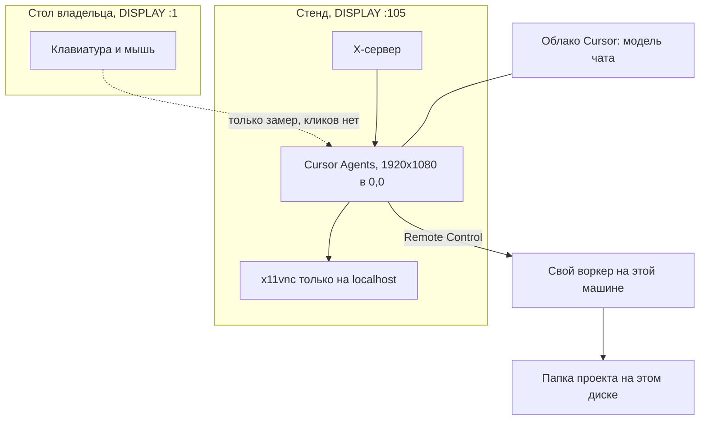
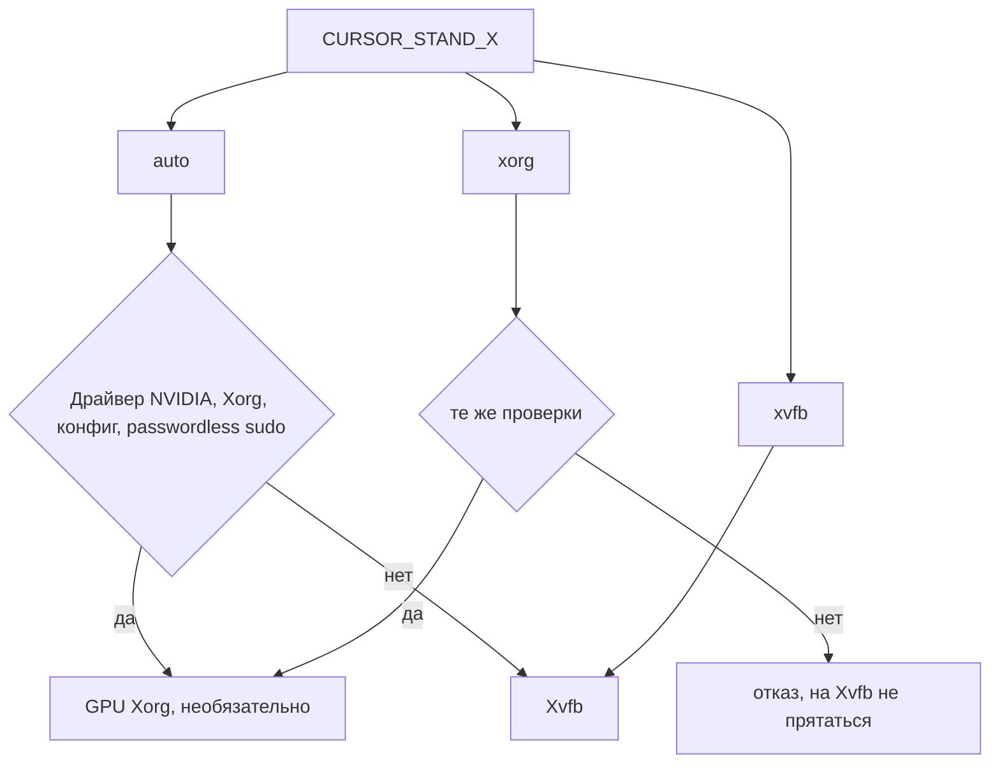
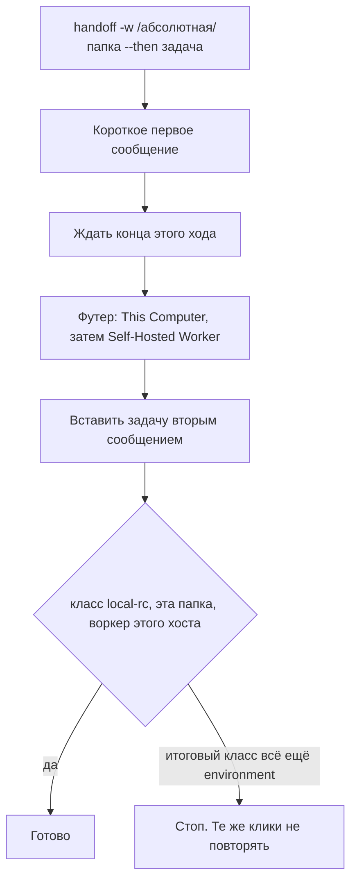

# Curskill (Agents Window + Remote Control)

Английский — источник правды, его и выполняет агент: [SKILL.md](SKILL.md).
Зачем стенд существует: [README.ru.md](../README.ru.md).

Штатного API «новая вкладка glass + `/remote-control`» нет. CLI `agent` и
Cloud Agents — **другие** сессии. Клики по столу владельца запрещены.
Рабочий путь: computer-use на **своём** DISPLAY.

Это оркестратор сессий Cursor Agents Window на Linux и X11. Не Windows, не macOS, не Wayland.

<a id="layout"></a>

## Как это устроено

Стол владельца и стенд не делят мышь.



Чем рисовать окно — необязательный выбор. Клики и проверка успеха те же.

Cursor Agents — окно Electron, его должен кто-то нарисовать. Xvfb рисует процессором, llvmpipe или SwiftShader, около 0,6 ядра, пока окно живёт. Это целый стенд: тот же OCR, тот же handoff, без root, и видеокарта, за которой может сидеть человек, не трогается. NVIDIA Xorg рисует то же окно на карте. Поэтому стенд, который оставляют на весь день, берёт карту, когда может: процессор освобождается, сессия не меняется. Карту берут только для NVIDIA, только если Xorg стартует без пароля и только если у монитора никого нет. AMD и Intel не сделаны. `CURSOR_STAND_X=xvfb` специально обходит карту. `auto` берёт её, когда все части на месте, иначе говорит об этом и берёт Xvfb. `xorg` значит карта или отказ, не тихий откат.



Новая сессия — одна последовательность. Картинка со словами «This Computer» — не её конец.



Смотреть строку после того, как `handoff` вернулся. Пока `convert-ok` ещё ждёт, папка с GitHub может читаться как `class=environment` и `workspaceRootPath=/workspace`. Замер 25.11.2026 на k-99: `/data/pro/mqlab` (`gitRepo:github.com/kogriv/mqlab`) была environment с 10-й по 50-ю секунду и стала `local-rc` на 60-й. В тот же день `/tmp/curskill-e2e-20261125` без GitHub-remote стала `local-rc` на 8-й секунде. Средняя строка — не повод останавливаться, переименовывать или запускать второй handoff. Стоп — только если закончившаяся команда всё ещё сообщает environment. Подробности: [reference.ru.md](reference.ru.md).

**Новая машина.** Сначала [SETUP.ru.md](../SETUP.ru.md): требования, файл хоста,
согласие человека. `scripts/setup.sh` только проверяет команды и ничего не
ставит. Пока в файле хоста нет `CURSKILL_SETUP_DONE=1`, `doctor` по glass
не кликает. `up` и таймер — после фразы человека «поднимай».

**Перед любой работой на уже настроенном стенде** перечитай этот `SKILL.md`
с диска и запусти `scripts/doctor.sh`. На свободном живом стенде при
`CURSKILL_SETUP_DONE=1` doctor кликает `handoff --dry-run` (без Return и
без текста). Занятый стенд он не кликает. Экран — [display.ru.md](display.ru.md),
хосты — [hosts.ru.md](hosts.ru.md), отказы — [reference.ru.md](reference.ru.md).

## Кто читает этот скилл

Одна копия на двух агентов: Cursor берёт `.cursor/skills/curskill/`,
Claude Code — `.claude/skills/curskill` (симлинк на неё же). Всё ниже
этого раздела общее; различия — только здесь.

| | агент Cursor (glass / RC на стенде) | Claude Code (tmux на хосте) |
|---|---|---|
| где лежит | `skill/` репо `curskill`; `install/install.sh` вешает `~/.cursor/skills/curskill` | тот же `skill/` через `~/.claude/skills/curskill` |
| как подхватить | новый чат в папке, где скилл установлен; явно `/curskill` | новая или перезапущенная сессия; явно `/curskill` |
| проверить, что виден | Customize → Skills | скилл в списке сессии; `/curskill` не «Unknown skill» |
| чем опасны `park`, `ensure`, перезапуск Cursor стенда | **убьёшь себя**: твой воркер — процесс этого Cursor, ход оборвётся | убьёшь **чужих** работающих агентов: сначала `scripts/glass.sh busy "$(hostname)"` |
| `DISPLAY` по умолчанию | часто `:105` (стенд) | пусто или `:1` (стол владельца) — всегда явно `DISPLAY=` стенда |
| кто твой воркер | `--worker-dir` твоей папки `@ <hostname>` из профиля стенда | воркеров нет; ты не в `glass.sh mine` |

Общее для обоих:

- Канон скриптов — `automation/cursor-stand.sh` в том же репо, рядом с
  `skill/`. Ставит `install/install.sh`: симлинки
  `~/.cursor/skills/curskill` и `~/.claude/skills/curskill` на `skill/`.
  `install/install.sh` вешает только симлинки скилла. Таймер стенда и
  уже запущенный экран он не переключает.
- Сессия в воркспейсе без установленного скилла его не подхватит.
- Автовызов включён (`disable-model-invocation` нет): description должен
  сработать на «поднять агента / RC / rename / MCP».
- Наблюдения, не проверенные документацией Cursor (07.10.2026): RC /
  self-hosted worker не видит `~/.cursor/skills/`; чат, начатый до появления
  скилла, его не подхватывает.

## Скрипты — вызывать, не переписывать

Канон (git): `automation/cursor-stand.sh`, `glass_agents.py`.
Экран **не копировать** в skill: свой
`automation/display/stand-display.sh`. Другой скрипт экрана задаётся
`CURSOR_STAND_DISPLAY_SH`.

Пути ниже — от корня этого скилла. `scripts/stand.sh` резолвит канон
(`CURSOR_STAND_SH=` если надо).

```bash
scripts/doctor.sh
scripts/pick-display.sh
scripts/stand.sh status
scripts/stand.sh up                          # без пути папки в argv
scripts/stand.sh workers                     # воркеры папок @ этой машины
scripts/stand.sh ensure                      # то, что делает таймер; руками — по просьбе
scripts/stand.sh handoff -w /ABS/PROJECT -n имя --then 'задача'
scripts/stand.sh handoff -w /ABS --no-convert   # локальный чат; потом convert
scripts/stand.sh convert --id <uuid|bc-|имя> [-w /ABS] [-n имя]
scripts/stand.sh convert --id … --dry-run
scripts/wait-worker.sh /ABS/PROJECT
scripts/stand.sh composer-send --id bc-…     # resend; поле ввода — по снимку
scripts/stand.sh rename --id bc-… имя
scripts/stand.sh archive --id bc-…           # пробные/ошибочные; не выполняющуюся
scripts/stand.sh mcp list                    # Customize → MCPs
scripts/stand.sh mcp find NAME
scripts/stand.sh mcp enable NAME             # тоггл источника ON
scripts/stand.sh mcp disable NAME
scripts/stand.sh mcp add -w /ABS -n NAME --command /path [--arg …]
scripts/stand.sh mcp add --user -n NAME --command /path
scripts/stand.sh settings agents             # Settings → Agents, только чтение
scripts/stand.sh shot
scripts/glass.sh selected
scripts/glass.sh newest /ABS/PROJECT [since_ms]   # только class=local-rc
scripts/glass.sh show bc-…
scripts/glass.sh created-since <epoch_ms>
scripts/glass.sh handoff-ok /ABS/PROJECT [since_ms [uuid]]
scripts/glass.sh mine "$(hostname)"          # local-rc + local; колонка working
scripts/glass.sh busy "$(hostname)"          # status=1 и локальный selected без записи
```

Клики handoff / MCP — якоря OCR в `glass_agents.py`, не фиксированные точки.
Не кликай `xdotool` с голоса, пока есть команда скрипта. После смены UI
Cursor — `doctor` / `handoff --dry-run`; неузнанный якорь = отказ до
Return, читай [reference.ru.md](reference.ru.md).

Текст на стенд: не `xdotool type` (IBus молчит). Скрипт —
`xclip -display $DISP` + ctrl+v.

## Экран и рендер

Стенд — **второй X-сервер**, не окно на столе владельца.

| слой | что |
|---|---|
| Дисплей | `CURSOR_STAND_DISPLAY` дефолт `:105` |
| Окно glass | на этом дисплее, `0,0` × `1920×1080` (`agents_window`) |
| Просмотр | x11vnc `localhost:5916` (`-localhost`, без пароля на loopback) |
| Стол | `CURSOR_STAND_ORIG_DISPLAY` дефолт `:1` — только замер мыши |
| Клавиатура стола | не забирается: `AutoAddDevices off`, `-sharevts -novtswitch` |

Выбор **чем рисовать** — `CURSOR_STAND_X` (читает `stand-display.sh`), не
интервью в чате. Перед первым `up` на хосте: `scripts/pick-display.sh`.

| `CURSOR_STAND_X` | поведение |
|---|---|
| `auto` (дефолт, текущая схема) | NVIDIA Xorg, если есть `nvidia_drv.so` + xorg-conf + `Xorg` + NOPASSWD/обёртка; иначе **громкий** откат на Xvfb |
| `xorg` | только GPU Xorg, иначе отказ (тихого Xvfb нет) |
| `xvfb` | сразу программный рендер |

Видеокарта необязательна. Зачем она и когда её не брать — в
[Как это устроено](#layout). Таблица ниже только переключатель.
Только NVIDIA. AMD, Intel и Wayland не сделаны.

Не поднимай второй Xorg на той же карте, пока человек за физическим
монитором: экран может моргнуть. Если `:1` недоступен, изоляцию мыши
не измерить — это не запрет handoff.

Живой `:105` `up` не дублирует (не второй Xorg). Калибровка прибита к `:105`.

Полный разбор: [display.ru.md](display.ru.md).

## Версия UI и ловушка Environment (07.10.2026)

Пакет, на котором сняты якоря: **3.30** (раньше 3.23). Запрета по
номеру версии нет (BL-007): отказ — неузнанный якорь на снимке. Якоря handoff
работают на 3.30 (синк 389fa7d); `composer-pos` получил 3.30-фолбэк по якорю
`send-follow-up`, когда футер стал «This Computer (Self-Hosted Worker)» и
«@ host» из него пропал. `CURSOR_STAND_UI_CALIBRATED`
(дефолт 3.23, справка в `doctor` / `ui-checked`) пока не поднят до 3.30 —
обновить при полной реверификации UI.

**Как получается local-rc на 3.23.** Return в новом чате даёт локальный
uuid без `bc-`. **Задача — вторым сообщением** (`--then` / `--then-file`):
первое короткое (дефолт READY), дождаться конца хода, конвертация, потом
задача. Длинный промпт первым — агент стартует до convert и Cursor показывает
«Move agent while it's working?» (13.10.2026). RC — конвертация: футер
«This Computer» (y>1040) → «Continue on» → «This Computer (Self-Hosted
Worker)» → если диалог uncommitted — **Exclude Changes** (не Include, не
Enter). Окно Move agent — только **Cancel/Esc**, никогда «Stop and Move».
Toast «Agent starting expensive processes» — закрывать **крестиком** до
поиска якорей (не Manage / Don't show again). sqlite: `bc-<uuid>`, ждать
до 90 с `convert-ok`. Пока ждёт, папка с git может показывать
`class=environment` и `/workspace`; стоп — это строка после ожидания, не
строка посередине (замер 25.11.2026, схема handoff выше). Слэш
`/remote-control` сам стартует Environment. Чип «Run on» → Self-Hosted
Worker — ловушка нового чата, не RC.

Сессию, у которой итоговый класс environment (`/workspace`), в
запрошенное имя не переименовывать.

Разбор sqlite: `scripts/glass.sh show bc-…`, `created-since`, `handoff-ok`,
`convert-ok`.

## Когда что делать

1. Пользователь просит новую десктопную сессию / RC / rename / MCP /
   статус стенда → этот skill, не Cloud Agents MCP, не `agent` CLI.
2. Незнакомый хост или странный status → `scripts/doctor.sh` и
   `pick-display.sh`.
3. `scripts/stand.sh status`: экран, логин glass, окно «Cursor Agents»,
   мышь стола, VNC.
4. Стенд не жив и пользователь **явно** просит поднять → `up` **без** пути
   папки (иначе IDE, не glass). Не `up` при человеке у монитора этой GPU.
   Это правило для ручного `up` агентом. Таймер `cursor-stand.timer` делает
   `ensure` (и `up`) сам после загрузки и каждые 5 мин — так решил владелец
   07.10.2026; обычно стенд уже поднят, сначала `status`.
5. Glass не залогинен → handoff не делать; логин владельца, не копия
   `state.vscdb`.
6. Последняя строка `doctor` содержит **ЗАБЛОКИРОВАН** → `stand.sh handoff`
   **не** вызывать, якоря не подбирать с голоса; нужен новый замер UI.
7. Новая сессия и doctor без блокировки →
   `handoff -w /абсолютный/путь [-n имя] --then 'задача'`. Длинный текст
   без `--then` — отказ. Скрипт сам откажет, если якорь не найден или
   convert не дал local-rc.
8. Локальный чат уже есть (handoff упал на convert / `--no-convert`) →
   дождись конца хода (`busy` / нет Stop), затем
   `convert --id <uuid> -w /ABS [-n имя]`. Не Archive и не Discard
   работающего локального uuid — `mine`/`busy` показывают `kind=local`.
9. Если send: `Selected private worker is not available` →
   `wait-worker.sh /тот/же/путь`, затем `stand.sh composer-send --id <bc-id>`
   (не второй New Chat, не второй `handoff` параллельно). Вид экрана не узнан —
   команда не кликает: `shot`, разбор, не координаты с голоса.
10. Проверка успеха (ниже) — по строке после возврата `handoff`:
    `handoff-ok`, не скриншот. Итоговый class=environment → стоп, не
    rename, не повтор теми же кликами. Строка environment, пока
    `convert-ok` ещё считает, этим стопом не является.
11. Скрипт ждёт имя в sqlite до 60 с и выходит, как только оно совпало.
    `rename --id bc-… имя` — только если после этого ожидания всё ещё
    написано, что имя не встало. Сессию с итоговым классом environment
    в запрошенное имя не переименовывать.
12. Ответ: URL `https://cursor.com/agents/<bc-id>`, **class=local-rc**,
    имя, папка (`workspaceRootPath`, не `/workspace`), footer
    `/path @ <hostname> (Self-Hosted Worker)`, что другие вкладки не трогал,
    мышь стола.
13. «Сессия должна видеть MCP» → не останавливаться на `mcp find`
    enabled: довести по разделу MCP (user json при необходимости) и
    проверить `composer-send` / namespace `ready`.

## Handoff и convert

Папка обязательна, **абсолютная**, существующий каталог проекта (не Home,
не No Repo, не Recents-имя, не GitHub-репо вместо пути, не
`~/.config/Cursor`, не профиль стенда). Скрипт вставляет путь в пикер
кликом по строке (не Return в поиске — иначе Recents/GitHub → Environment).
`/remote-control` **не** вызывать: на 3.23 слэш сам стартует Environment.

**Порядок (13.10.2026).** (1) Короткое первое сообщение (дефолт READY;
позиционный текст >120 символов — отказ). (2) Ждать конец хода (футер +
follow-up, и на экране нет «Planning next moves»). (3) Конвертация
футера → Self-Hosted Worker (`glass_convert_to_rc`, общий с `convert`).
Чип папки — подпись слева от This Computer. Слово `main` только ветка
внутри чипа. Чип, на котором уже имя папки, всё равно этот чип. (4) `--then` / `--then-file` —
второе сообщение через `composer-send`. `-n` — Rename только у local-rc.
`--no-convert` — оставить локальный чат (проба / recover). `--dry-run` не
жмёт Return и не конвертирует.

```bash
scripts/stand.sh handoff -w /path/to/project -n name --then-file /tmp/task.txt
scripts/stand.sh convert --id <uuid> -w /path/to/project -n name
scripts/stand.sh convert --id bc-… --dry-run
```

`convert`: открыть чат, убедиться что не работает (нет Stop; Move agent →
Cancel и отказ), футер → Worker, Exclude при uncommitted, `convert-ok`,
опционально `-n`. Чужие вкладки не трогать.

Перед якорями скрипт закрывает toast expensive-processes крестиком; при
диалоге Move agent жмёт Cancel и выходит. Не «Stop and Move», не
«Don't show again».

Имя: Cursor сам называет чат по первому сообщению. `-n` — после local-rc.
Старую сессию той же папки не переименовывать. Локальный uuid без записи
в `cloudAgentRepository` — не мусор: смотри `mine`/`busy` (`kind=local`).

Первый send в **новую** папку часто падает, пока нет daemon
`--worker-dir <папка>` из **профиля стенда**. Ключ из cmdline **не**
печатать. Один стенд на машину; новые агенты — **вкладки** glass.

## Rename

Ровно один селектор: `--id` (предпочтительно полный `bc-…`), `--from
'старое имя'`, `--current`, либо два аргумента `старое новое`. Сначала
Search Agents (Ctrl+Alt+P) по **bc-id**; sqlite `selectedAgent` должен
совпасть — иначе имя не менять. OCR коротких имён и
кириллицы врёт; `palette-ok` подтверждает uuid. Палитра не та — Escape,
не Return (иначе New agent). `/rename` CLI — другая сессия.

## MCP (Customize → MCPs → сессия RC)

Два разных критерия. Не путать.

| этап | что значит «ок» | чего недостаточно |
|---|---|---|
| UI | `mcp find NAME` → не `Disabled` (часто «N tools enabled») | файл `.cursor/mcp.json` без тоггла |
| сессия RC | агент этой папки видит namespace `NAME` (`ready`) в dynamic tools | только UI enable / только файл |

Проектный `.cursor/mcp.json` и пользовательский `~/.cursor/mcp.json`:
тоггл в Customize давали «87 tools enabled» в UI, но RC-агент namespace не
видел, пока сервер не появился ещё и в **user** `~/.cursor/mcp.json`, UI
перечитал источники, воркер папки пересобрал кэш
`$PROFILE/User/globalStorage/anysphere.cursor-agent-worker/worker-data/*/projects/<slug>/mcps/NAME/`
(есть `SERVER_METADATA.json` + `tools/`). Ручное копирование tool-JSON в
кэш даёт stale (`project-0-…` / `user-…` рядом с каноном) — не делать.

### Порядок доведения сервера до RC

1. Запись json (без секретов в argv): проект и/или user.
   ```bash
   scripts/stand.sh mcp add -w /ABS -n NAME --command /path [--arg …]
   # если RC после enable так и не видит namespace — тот же сервер в user:
   scripts/stand.sh mcp add --user -n NAME --command /path
   ```
2. Тоггл источника ON в Customize → MCPs (скрипт сам после `add`):
   ```bash
   scripts/stand.sh mcp find NAME    # UI
   scripts/stand.sh mcp enable NAME  # идемпотентно, если уже on
   ```
   Поиск Customize search **не** использовать (ломает вкладки). Форму
   «New MCP Server» скрипт не заполняет.
3. Вкладка сессии папки открыта → воркер жив (`wait-worker` / `workers`).
   При необходимости Reload в панели MCP / Done после тоггла; не `park`
   «на всякий случай» (убьёт чужие ходы).
4. Проверка **сессии**, не только UI:
   ```bash
   scripts/stand.sh focus --id bc-…
   scripts/stand.sh composer-send --id bc-… \
     'Reply one line: is namespace NAME in your dynamic tools? ready/missing.'
   ```
   Успех: ответ агента `ready` **или** в кэше воркера канон
   `…/mcps/NAME/` с tools и без необходимости дублей. OCR `mcp list` может
   показать две строки одного имени (project + user) — норма, пока сессия
   видит один namespace `ready`.
5. После синхронизации устаревшие каталоги `project-0-NAME` / `user-NAME` в
   кэше воркера можно удалить; канон `NAME` оставить. Не чистить кэш, пока
   сессия ещё `missing`.

```bash
scripts/stand.sh mcp list
scripts/stand.sh mcp find NAME
scripts/stand.sh mcp enable NAME
scripts/stand.sh mcp disable NAME
scripts/stand.sh mcp add -w /path/to/project -n name --command /path/to/server.py
scripts/stand.sh mcp add --user -n name --command /path/to/server.py
```

Секреты прокси сервер читает сам (`~/.config/…`), в чат и git не класть.
После смены UI якоря `customize` / `customize-mcps` / тоггл — отказ, не
координаты с голоса. Детали OCR/кэша — [reference.ru.md](reference.ru.md).

`mcp list` печатает статус `enabled`, `disabled` или `error` и строку под
именем («109 tools enabled», «7 tools, 5 resources enabled», «Error Show
Output»). Короткое имя вроде `n8n` OCR часто читает как `gn` или `nan`:
скрипт сверяет вырезку с именами из mcp.json. Одиночный дефис и одна буква
именем сервера не считаются.

## Settings → Agents (только чтение)

```bash
scripts/stand.sh settings agents
```

Открывает File → Settings → Agents, пролистывает страницу и печатает
тумблеры и выпадающие списки. Ничего не переключает. Тумблер читается по
цвету дорожки (зелёная = on, серая = off), значение списка — вырезкой
справа от подписи.

Строки, без которых команда отказывается: Remote Control (и подпись
Connected), self-hosted workers, очередь новых сообщений, Run Mode, Read
Access, защита удаления, защита файлов вне папки, Web Search, ожидание
MCP. Ниже по странице ещё Computer Use (список всегда разрешённых
приложений) и Legacy Terminal.

Куда скрипт не кликает, даже если надпись видна: Cloud Agents и Docs
(открывают браузер), Unregister All, Log Out, Manage Environment, карточка
Build on App, поиск настроек и поиск Customize. Строка проекта в сайдбаре
тоже не цель: у неё меню с Log Out. Если безопасной точки нет — отказ и
снимок, не соседняя координата.

## Рестарт стенда

| команда | что гасит | что оставляет |
|---|---|---|
| `park` | Cursor стенда + его worker’ы | `:105`, VNC, inbox в вебе |
| `down` | park + x11vnc | экран |
| `down-display` | экран `:105` по PID | ничего; **запрещено** при живом glass |

`park`/`down` ставят `$PROFILE/var/hold` — таймер `ensure` не поднимает.
Снимает `up`. Живой lock `~/.config/Cursor` не убивать.

Inbox облачный: список сессий переживает park. RC follow-up — после `up`
и открытой вкладки этой папки (`workers` / `ensure` на свежем скрипте).
`ensure` не вызывать «на всякий случай» из соседнего чата; таймер
`cursor-stand.timer` не enable/disable без просьбы.

История CLI (`~/.cursor/chats/.../store.db`) в glass **не** resume. Можно
дать путь к `store.db` в промпте новой desktop-сессии как бриф.

## Успех handoff

Все пункты. Скриншот «This Computer» / «Set up Environment» — **не** успех.

- `scripts/glass.sh handoff-ok /ABS/PROJECT [since_ms [uuid]]` код 0;
- `class=local-rc` (не `environment`, не `private-incomplete`);
- `workspaceRootPath` = запрошенный путь (**не** `/workspace`);
- `privateWorkerDisplayName` содержит этот путь и `@ <hostname>`;
- `cloudTargetKey` не решает сам: смотри `class` и `workspaceRootPath`;
- новая `bc-id`; имя, если просили `-n` (только у local-rc);
- footer `/path @ <hostname> (Self-Hosted Worker)` / Remote Control;
  кнопка Set up Environment на этой вкладке **не** отменяет успех;
- мышь стола не сдвинулась **или** была `unavailable`;
- другие bc-id не переименованы.

Если у закончившейся команды класс всё ещё `environment`: стоп. Не
rename, не второй `handoff` теми же кликами, в ответ пользователю —
bc-id, class, `workspaceRootPath`, `cloudTargetKey`. Строка, которая
была environment только пока `convert-ok` ждал, этим случаем не является.

```bash
scripts/glass.sh created-since <epoch_ms>
scripts/glass.sh handoff-ok /ABS/PROJECT <epoch_ms> [uuid]
scripts/glass.sh show bc-…
scripts/glass.sh selected
scripts/stand.sh shot
```

## Запреты (пока пользователь не сказал иначе)

- `xdotool` / `wmctrl` / `scrot` без `DISPLAY=` стенда (дефолт агента часто `:1`).
- `cursor` / `cursor-proxy` без `--user-data-dir` профиля стенда.
- `pkill Xorg`, `pkill cursor`. Стоп экрана — только `down-display` своего DISPLAY.
- Копия живого `~/.config/Cursor` / `state.vscdb` / worker keys / OTP / пароли в git, скилл, argv, чат.
- `park`, `down`, `down-display` — только по явной просьбе.
- Второй Xorg / второй профиль «на сессию».
- Cloud Agents / `agent create-chat` вместо glass RC.
- `up /path` (путь в argv).
- Тихий Xvfb, когда просили GPU (`CURSOR_STAND_X=xorg` тогда обязан упасть).
- Считать успехом скриншот без bc-id и мыши стола.
- Считать успехом «This Computer», «Set up Environment»,
  `workspaceRootPath=/workspace` или GitHub-репо вместо пути на диске.
- Переименовывать Environment-сессию в запрошенное имя.
- Повторный `handoff` теми же кликами после отказа `handoff-ok`.
- Слэш `/remote-control` или клик Self-Hosted Worker в чипе «Run on»
  нового чата (это Environment, не RC).
- Include Changes / Enter в диалоге uncommitted (Enter = Include).
- «Stop and Move» в диалоге Move agent while working (только Cancel/Esc).
- «Manage Processes» / «Don't show again» на toast expensive-processes
  (только крестик).
- Archive / Discard работающего локального чата без bc- (`mine`/`busy`
  показывают `local`) — сначала дождаться хода и `convert`.
- Длинный промпт первым сообщением handoff без `--then`.
- Archive All Below в сайдбаре (сейф для локального черновика — Discard).
- Выдумывать координаты / крутить xdotool с голоса.
- Писать в ответ API keys из `/proc/*/cmdline`.
- В настройках стенда кликать Cloud Agents, Docs, Unregister All, Log Out,
  Manage Environment, Build on App. Это делает браузер, снимает регистрацию
  или выходит из аккаунта. Чтение страницы — `settings agents`.
- Печатать в поле поиска Customize или Settings.

## Хосты (кратко)

Один стенд на машину. Сессия, заведённая на A, получает worker `@ A`.
Та же строка в сайдбаре B (общий аккаунт) тулы на B **не** исполняет.

Профиль машины — `config/hosts/$(hostname).env`. Имена хостов, порты и
GPU туда, не в этот скилл. См. [hosts.ru.md](hosts.ru.md).

## Env

| переменная | смысл | дефолт |
|---|---|---|
| `CURSOR_STAND_SH` | путь к `cursor-stand.sh` | резолв `scripts/stand.sh` |
| `CURSOR_STAND_PROFILE` | `--user-data-dir` | `$XDG_DATA_HOME/cursor-stand` или `~/.local/share/cursor-stand` |
| `CURSOR_STAND_DISPLAY` | glass | `:105` |
| `CURSOR_STAND_VNC` | x11vnc | `5916` |
| `CURSOR_STAND_ORIG_DISPLAY` | стол, замер мыши | `:1` |
| `CURSOR_STAND_DISPLAY_SH` | экран | `automation/display/stand-display.sh` |
| `CURSOR_STAND_BIN` | бинарь | `/usr/local/bin/cursor-proxy` |
| `CURSOR_STAND_PROXY` | HTTP proxy Cursor | пусто (без прокси); URL только из ответа человека в `config/hosts/<host>.env` |
| `CURSKILL_SETUP_DONE` | doctor может кликать dry-run | пусто, пока человек не ответил. `1` закрывает настройку |
| `CURSOR_STAND_CONFIG` | файл профиля машины | `config/hosts/$(hostname).env`, если есть |
| `CURSOR_STAND_X` | `auto` \| `xorg` \| `xvfb` | `auto` |
| `CURSOR_STAND_WAIT_WORKER_SEC` | таймаут wait-worker | `120` |
| `CURSOR_STAND_UI_CALIBRATED` | мажор.минор якорей (справка) | `3.23` |

Runtime, снимки, `state.env`, `hold` — `$PROFILE/var`, вне git.

## Лабораторные доки (не копипастить в ответ пользователю)

- экран — [display.ru.md](display.ru.md)
- хосты — [hosts.ru.md](hosts.ru.md)
- отказы, координаты, sqlite — [reference.ru.md](reference.ru.md)
